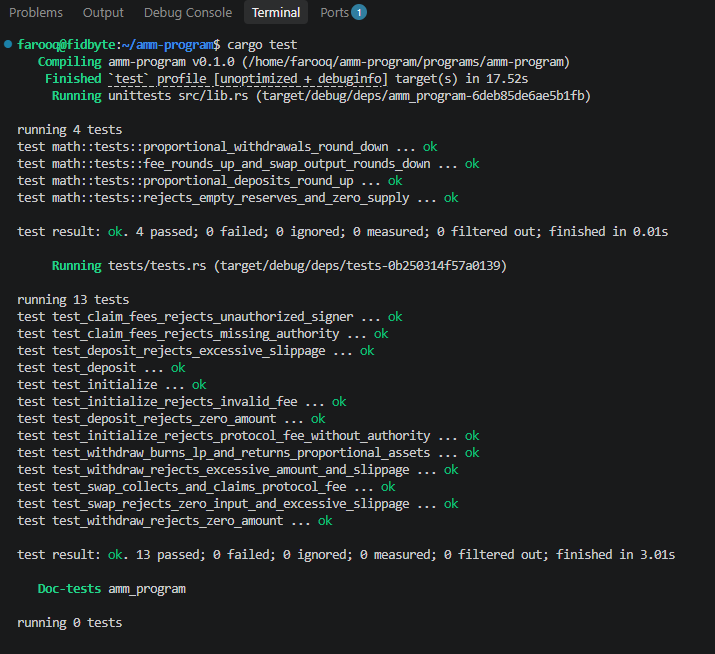

# AMM Program

An Anchor program for a Solana constant-product automated market maker. Pools hold two SPL tokens and price swaps according to the constant-product curve, `x * y = k`.

> **Status:** Experimental. This code has not had an independent security audit and is not ready to custody production funds.

## What it supports

- Pool initialization with a trading fee and optional protocol fee.
- Initial and proportional liquidity deposits that mint pool LP tokens.
- Proportional liquidity withdrawals that burn LP tokens and return both pool assets.
- Swaps in either direction with a minimum-output slippage bound.
- Protocol-fee collection by the configured authority.
- Checked integer math for fee and curve calculations.

The pool's `locked` state is checked by deposits and swaps, but there is no instruction to change it. Withdrawals remain available regardless of that flag so users can exit during a pause. A pause-management instruction is still a pre-production gap.

## Repository layout

```text
programs/amm-program/
  src/
    instructions/   Anchor account contexts and instruction logic
    math.rs          Constant-product and fee calculations
    state.rs         Pool configuration account
  tests/
    ix_handlers/     LiteSVM instruction builders
    tests.rs         Instruction integration tests
Anchor.toml          Anchor workspace and test configuration
```

## Fee, swap, and withdrawal behavior

Fee values are expressed in basis points, where 10,000 bps is 100%. The protocol fee cannot exceed the trading fee. A nonzero protocol fee requires a configured authority.

For swaps, `x_to_y = true` means token X is deposited and token Y is received. `minimum_amount_out` is enforced before token transfers. Fees and deposit requirements round up, while withdrawal amounts and swap outputs round down. These directions avoid granting value through integer rounding.

Withdrawals specify the LP amount to burn and minimum token X and Y outputs. The program calculates each output in proportion to the current reserves and LP supply, checks both minimums, burns the user's LP tokens, then transfers assets from the pool's PDA-controlled vaults.

## Build and test

The workspace pins Rust through [`rust-toolchain.toml`](./rust-toolchain.toml). Install the Solana CLI and a compatible Anchor CLI, then build the program before running the LiteSVM integration tests:

```bash
anchor build
cargo test
```

The test binary loads the compiled program from `target/deploy/amm_program.so`. `anchor build` also generates the IDL under `target/idl/`.

### Latest test run

The screenshot below records a successful `cargo test` run.



## Downtime mitigation reasoning

Availability has separate failure points: the Solana cluster, the RPC endpoint used by the app, and the app's own services. I would monitor each independently and configure more than one RPC provider. On provider failure, reads can fail over after checking slot freshness. Writes should not be replayed blindly: first check whether the original transaction landed, then refresh its blockhash and rebuild only when needed. When data is stale or writes cannot be confirmed, the interface should say so and switch to read-only behavior rather than quote trades it cannot safely submit.

For a program-level incident, the protocol needs a tested way to stop new risk. This code checks a `locked` flag for deposits and swaps, and the withdrawal instruction intentionally does not check it. No instruction currently sets that flag. Before production, I would add a narrowly scoped emergency pause authority, separate from the fee-claim authority. It should be possible to pause quickly, while unpausing should require multisig approval. A pause should block new swaps and deposits without blocking withdrawals or fee claims when those operations remain safe.

The withdrawal path gives liquidity providers an on-chain exit, but it does not replace incident planning. I would test it under paused and degraded conditions, define which operations remain available during an incident, and rehearse the pause and recovery process before any mainnet deployment. Alerts for transaction failures, RPC lag, pool state, and program upgrades should feed a runbook with clear owners and user communication steps.

## Security and deployment

This repository is a development starting point, not a production deployment package. Before handling real liquidity, test withdrawal and emergency-control behavior under adversarial conditions, review upgrade authority and key custody, and obtain an independent security review. Do not treat passing tests as an audit.